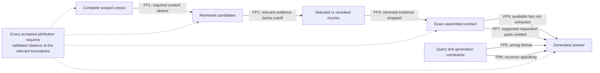

# Diagnostic Engine Architecture Diagram

The current stage-based architecture is documented in
[Stage-based diagnosis](docs/stage-diagnosis.md), including its Mermaid diagram.
The diagrams below show the prior FP1–FP7 compatibility architecture.

```mermaid
flowchart TB
    subgraph Producer["RAG Pipeline — Telemetry Producer"]
        direction LR
        Q["User query"]
        QE["Query embedding"]
        RET["Vector retrieval<br/>chunks, ranks, similarity scores"]
        RR["Optional reranking<br/>or status: not_used"]
        CTX["Context assembly<br/>exact prompt context"]
        GEN["Generation<br/>instructions, model, answer"]

        Q --> QE --> RET --> RR --> CTX --> GEN
    end

    subgraph Build["Index-Build Evidence"]
        direction LR
        CORPUS["Corpus snapshot"]
        PARSE["Parsed documents"]
        CHUNK["Chunks and source metadata"]
        EMBED["Document embeddings"]
        INDEX["Index manifest"]

        CORPUS --> PARSE --> CHUNK --> EMBED --> INDEX
    end

    GEN --> ENVELOPE["Versioned execution envelope<br/>run_id · stages · final answer"]
    INDEX -->|"checksummed artifact references"| ENVELOPE
    FLAG["Failure signal<br/>flagged: true + reason"] --> ENVELOPE
    ENVELOPE --> STORE[("JSON / JSONL<br/>telemetry store")]

    subgraph Ingestion["Independent Trace Ingestion"]
        direction TB
        LOAD["Load terminal execution<br/>and select run_id"]
        VERIFY["Verify schema, status,<br/>paths, manifests, SHA-256"]
        HYDRATE["Hydrate captured corpus<br/>and index-build artifacts"]
        NORMALIZE["Normalize stable artifacts<br/>and build bounded judge view"]

        LOAD --> VERIFY --> HYDRATE --> NORMALIZE
    end

    STORE --> LOAD
    VERIFY -->|"missing, damaged, or unsafe evidence"| LIMITS["Inspection errors<br/>affected checks remain unknown"]
    LIMITS --> NORMALIZE

    subgraph Judge["Answer-Agnostic LLM-as-a-Judge"]
        direction TB
        PROMPT["Structured forensic prompt<br/>no reference answer · no world knowledge"]
        GEMINI["Gemini 2.5 Flash Lite<br/>temperature: 0.1 · JSON schema"]
        MATRIX["Sequential FP1–FP7 assessment<br/>fault · clear · unknown · not_applicable"]

        PROMPT --> GEMINI --> MATRIX
    end

    NORMALIZE --> PROMPT

    subgraph Guardrails["Deterministic Attribution Guardrails"]
        direction TB
        SCHEMA["Exact response schema<br/>all seven categories once"]
        CITE["Verbatim artifact citations<br/>valid IDs and nonempty quotes"]
        BOUNDARY["Category-specific boundary rules<br/>required upstream/downstream evidence"]
        CONF["Confidence threshold<br/>abstain_below: 0.7"]
        MULTI["Primary cause normalization<br/>independent contributing-stage evidence"]

        SCHEMA --> CITE --> BOUNDARY --> CONF --> MULTI
    end

    MATRIX --> SCHEMA
    MULTI --> DECISION{"Any supported fault?"}

    DECISION -->|"Yes"| DIAG["DIAGNOSED<br/>primary FP category and stage<br/>plus supported contributors"]
    DECISION -->|"No, unresolved checks"| ABSTAIN["ABSTAINED<br/>failure_category: ABSTAIN"]
    DECISION -->|"No, all checks resolved"| CLEAR["NO FAILURE<br/>failure_category: NONE"]

    DIAG --> REPORT[("Structured JSON report")]
    ABSTAIN --> REPORT
    CLEAR --> REPORT

    REPORT --> AUDIT["Audit record<br/>trace · evidence · confidence<br/>config · code revision · model metadata"]
    REPORT --> RUNS["runs/reports/{run-id-hash}.json<br/>runs/diagnoses.jsonl"]

    classDef producer fill:#dbeafe,stroke:#2563eb,color:#172554
    classDef evidence fill:#ecfccb,stroke:#65a30d,color:#1a2e05
    classDef ingestion fill:#f3e8ff,stroke:#9333ea,color:#3b0764
    classDef judge fill:#fef3c7,stroke:#d97706,color:#451a03
    classDef guard fill:#fee2e2,stroke:#dc2626,color:#450a0a
    classDef outcome fill:#e0f2fe,stroke:#0284c7,color:#082f49
    classDef abstain fill:#fef9c3,stroke:#ca8a04,color:#422006

    class Q,QE,RET,RR,CTX,GEN,ENVELOPE,FLAG producer
    class CORPUS,PARSE,CHUNK,EMBED,INDEX,STORE evidence
    class LOAD,VERIFY,HYDRATE,NORMALIZE,LIMITS ingestion
    class PROMPT,GEMINI,MATRIX judge
    class SCHEMA,CITE,BOUNDARY,CONF,MULTI,DECISION guard
    class DIAG,CLEAR,REPORT,AUDIT,RUNS outcome
    class ABSTAIN abstain
```

## Failure-Point Attribution Map

