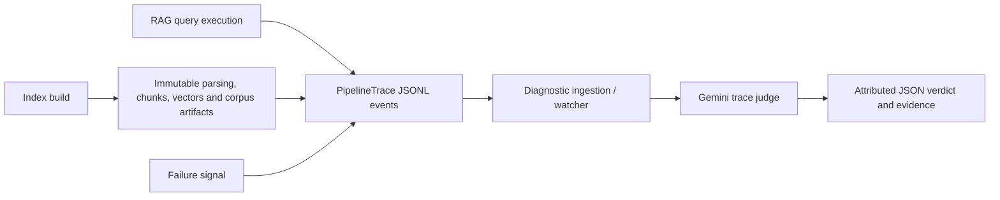

# Execution telemetry and RAG failure attribution

`rag_pipeline` emits execution records. `rag_diagnostic` consumes those records,
inspects stage boundaries and captured corpus evidence, and returns a structured
FP1–FP7 attribution using the Gemini LLM judge. The ingestion path does not import
or execute the reference pipeline. No reference answer or known answer location
is required or accepted.



## Capture, flag, and diagnose

Activate the project environment, install the project with `python -m pip install
-e '.[dev]'`, and set `GEMINI_API_KEY` in the ignored `.env` file. Both generation
and judging default to `gemini-3.5-flash-lite`.

Indexing automatically captures its build artifacts:

```bash
rag-pipeline index
```

Every query automatically produces a structured JSONL trace in
`RAG_DIAGNOSTICS_DIR` (default `data/diagnostics`). The pipeline prints its path:

```bash
rag-pipeline ask "What methods improve retrieval quality?"
```

After an engineer or an application flags the returned response as failing:

```bash
rag-diagnose flag --trace /path/to/execution.jsonl --reason "Response omitted requested details"
```

Consume that captured execution and emit the structured verdict:

```bash
rag-diagnose ingest --trace /path/to/execution.jsonl --json --report-out runs/report.json
```

The query, retrieval, and generation are **not rerun**. The only inference is the
judge's assessment of captured observations. A producer can already know the run
should be reviewed and attach the signal during execution:

```bash
rag-pipeline ask "What methods improve retrieval quality?" --failure-reason "Flagged by response monitoring"
```

For automatic asynchronous consumption, run the local file-store watcher:

```bash
rag-diagnose watch --trace-dir data/diagnostics --config configs/diagnostic.json --json
```

Only terminal executions with `failure_signal.flagged: true` are processed.
Operational query failures are published and flagged automatically. Use `--once`
for a single poll or a scheduled job; `--poll-interval` controls the continuous
consumer. The worker is intentionally started separately from the RAG application.
Unflagged runs incur no judge call. Stop the worker with Ctrl-C.

The watcher persists processed input/configuration identities in
`runs/ingestion.json`, writes JSON reports under `runs/reports`, and preserves the
producer's `run_id`. Repeated deliveries and clean worker restarts skip processed
inputs. A crash before checkpointing can repeat a report write; the judge cache
prevents another model call for identical observed inputs. Provider errors leave
the run unacknowledged so a supervisor can retry after resolving the error.

## Python interfaces

The producer can call `pipeline.ask(query)` or `pipeline.run_with_trace(query)`.
Both call the same execution function and automatically publish the same stage
telemetry. `pipeline.flag_last_run(reason)` appends a failure signal for the most
recent execution. `PipelineTrace.flag(path, reason)` flags a published log directly.

The consumer accepts the producer's log or a standalone JSON envelope:

```python
from pathlib import Path
from rag_diagnostic.config import DiagnosticConfig
from rag_diagnostic.diagnostic_engine import DiagnosticEngine
from rag_diagnostic.ingestion import TelemetryIngestor

consumer = TelemetryIngestor(DiagnosticEngine(DiagnosticConfig()))
verdict, report_path = consumer.ingest(Path("data/diagnostics/execution.jsonl"))
print(verdict.to_dict())
```

Services with telemetry already loaded from a database, message queue, or trace
collector can pass the execution dictionary directly to
`DiagnosticEngine(config).diagnose(payload)`. The local watcher implements a file
store transport; no OpenTelemetry collector, HTTP endpoint, or database deployment
is required or configured by this change.

## Standard producer contract

[telemetry.schema.json](telemetry.schema.json) defines the v1 envelope. Its fields
are `schema_version: "1.0"`, a stable `run_id`, `query`, `execution_status`
(`completed` or `failed`), `pipeline` settings/code identity, and `stages`.
`final_answer` is present only if generation actually returned an answer.
`failure_signal` contains a boolean `flagged` and an optional textual `reason`.
The failure reason routes the record; it is not treated as a trusted fault label.

Each observed stage records `status`, exact `input_data`, exact `output_data`, and
an error when execution failed. Omit unobserved output fields. An observed empty
array/string and a missing stage are different evidence states. `not_used` means
the producer deliberately bypassed a stage. The reference pipeline currently has
no reranker and records it as `not_used`; external systems should emit their real
reranking results.

| Stage | Captured evidence |
|---|---|
| Parsing | Parsed document/section text with source metadata, recorded during indexing. |
| Chunking | Actual stable chunk IDs, source IDs, text, section/chunk metadata. |
| Document embedding | Chunk-to-vector mapping and configured embedding model. |
| Indexing | Build lineage, embedding model, collection and indexed chunk count. |
| Query embedding | Actual model input and the query vector used for retrieval. |
| Retrieval | Requested cutoff and returned chunk IDs, text, source metadata, ranks and similarity scores. |
| Reranking | Actual reordered outputs, or an explicit unused stage. |
| Context assembly | Selected chunk IDs and exact model context text. |
| Generation | Actual prompt, system instructions, model, temperature, and response. |

Retrieval/reranking outputs use arrays of objects with `chunk_id`, `doc_id`, `text`,
positive one-based `rank`, and `score`. Their `k` is the applicable selection
cutoff. Context output is the exact string or `{chunk_ids, text}`. A corpus snapshot
contains `{documents: [{doc_id, text}], snapshot_id, scope, complete}`. Declare
completeness only for the entire named snapshot; a bounded search, unreadable
source, sample, or truncated view is not complete.

Reference index builds persist artifacts under
`data/diagnostics/indexes/<index_run_id>/`. Query envelopes link their immutable
manifest via `pipeline.index_snapshot`. A locator under the Chroma directory
preserves this connection when the RAG process restarts. The consumer validates
manifest and artifact SHA-256 hashes before hydrating parsing, chunking, embedding,
and corpus data. These stages are marked `recorded_at: "index_build"`; they are not
misrepresented as having run anew on every query. A build reference describes the
recorded build, not unobserved changes made externally to the vector database.

Index-time corpus completeness is true only when every configured source JSON file
was represented and readable. Limited/partial builds remain incomplete. Source text
is captured at build time; ingestion does not silently substitute today's corpus
for historical evidence. Existing indexes built before telemetry was enabled
still support query diagnosis, but their unrecorded upstream evidence stays unknown.
A later deliberate index build will produce the additional artifacts. Ingestion
never resets or rebuilds the index.

Artifact paths must be relative to the authorized artifact root, normally the
trace file's directory. Checksums and path containment are enforced. If query logs
were moved or a separate diagnostics directory was used after indexing, pass
`--artifact-root /path/to/original/diagnostics` to ingestion/watching. Absolute paths
advertised by a producer are not automatically followed. Missing, damaged, or
inaccessible artifacts produce explicit inspection errors and cannot establish
corpus completeness. Self-contained external envelopes can supply stage outputs
and corpus documents directly without artifact files or an adapter.

JSONL transport uses `run_id`, `stage`, `status`, `inputs`, and `outputs` on each
event. A terminal `stage: "execution"` event carries the standard envelope in
`outputs`; `stage: "failure_flag"` signals review. Existing stage-only PipelineTrace
logs are also reconstructed when their query completion event is available.
In-progress records and partial trailing writes are retried. Multiple runs in a
file are processed independently; manual ingestion selects one using `--run-id`.

## Attribution and evidence limits

The judge evaluates every FP1–FP7 category and returns the primary category/stage,
all supported findings/contributors, confidence, concise justifications, and exact
artifact citations. The taxonomy follows
[Barnett et al., section 5](https://arxiv.org/pdf/2401.05856).

| Category | Required evidence |
|---|---|
| FP1 Missing Content | A complete named corpus view; absence from top-K alone is insufficient. |
| FP2 Missed Top Ranked | Relevant indexed evidence demonstrably below a selection cutoff. |
| FP3 Not in Context | Retrieved information lost before the exact model context. |
| FP4 Not Extracted | Required context facts not used in the response. |
| FP5 Wrong Format | An explicit format constraint violated by the response. |
| FP6 Incorrect Specificity | A supported mismatch between requested scope/detail and the answer. |
| FP7 Incomplete Answer | Requested parts omitted despite their facts being available in context. |

An external producer may include `deep_retrieval` results with `deep_k` to support
FP2. Live optional adapters can also gather such a probe. Saved-trace ingestion
never performs a new retrieval probe: absence of recorded deeper rank evidence
limits FP2 attribution. Parsing/chunking and embedding observations may support
contributors, but vector dimensions or hashes alone cannot establish embedding
quality. Do not force errors outside the seven semantic categories into one of
them. Recorded stage exceptions remain visible in `operational_failures` even
when semantic attribution abstains.

`diagnosed` means at least one fault is supported. `ABSTAIN` means no semantic
fault is supported and checks remain unresolved. `NONE` requires every category
to be confidently clear or inapplicable. Multiple faults and unknown categories
can coexist; `unresolved_categories` and `attribution_complete` expose these limits.
The confidence is an uncalibrated evidence score, not a measured probability.

Full vectors and source observations remain in the original recorded payload.
The judge sees vector dimensions/hashes and bounded source/chunk text views;
shortened views are explicitly incomplete. `corpus_budget_chars` is shared across raw corpus, parsed documents and chunk
text views and `max_judge_input_chars` caps the whole request. Over-budget requests
abstain. Exact citation checks constrain provenance, not semantic correctness.

Reports preserve the producer run ID, original telemetry, settings/revisions,
input fingerprints, actual judge prompt/schema, model reply and evidence findings.
They append to `runs/diagnoses.jsonl`. Cached replies are keyed by observed data,
settings, model, prompt/schema and code identity. Gemini requests use the shared
client and configurable pacing; no generation call occurs during ingestion.

## Optional direct execution

For interactive diagnosis, the prior connection remains available:

```bash
rag-diagnose "What methods improve retrieval quality?" --report-out runs/report.json --trace-out runs/trace.json
```

This mode deliberately executes the target once through `PipelineAdapter`; it is
separate from ingestion. The default adapter targets this repository's real
`RAGPipeline`. An external adapter can expose `run`, `describe`, `corpus_snapshot`,
optional deeper `retrieve`, and `generation_instructions`, but emitting standard
telemetry requires no adapter. Runtime inputs are queries and captured executions keyed by run ID.

Run verification with:

```bash
PYTEST_DISABLE_PLUGIN_AUTOLOAD=1 PYTHONPATH=src python3 -m pytest
```

Tests exercise real emission, artifact lineage, corpus inspection, independent
consumption, flags, partial writes, duplicate delivery, CLI ingestion and mocked
LLM attribution. They do not establish semantic judge accuracy; assess that against
human-reviewed failures from the intended domain.
