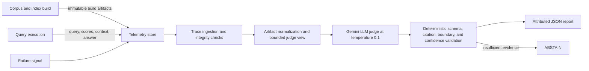

# RAG Diagnostic Engine Architecture

> The default architecture has migrated to stage-based technical mechanisms.
> See [the current architecture](docs/stage-diagnosis.md). The FP1–FP7 architecture
> below documents only explicit `assessment_mode: "legacy_fp"` compatibility mode.

## Purpose

The diagnostic engine identifies where and why a RAG execution failed without using a reference answer. It analyzes the evidence captured at pipeline boundaries, asks a low-temperature LLM judge to assess the Seven Failure Points of RAG (FP1–FP7), and then applies deterministic validation before accepting any attribution.

The result is an evidence-backed JSON report containing:

- the primary failure category and stage;
- any independently supported contributing stages;
- a confidence score;
- exact citations to captured artifacts;
- unresolved categories and attribution limits;
- the configuration, source revision, model metadata, and trace used for the run.

The taxonomy follows Barnett et al., [_Seven Failure Points When Engineering a Retrieval Augmented Generation System_](https://arxiv.org/pdf/2401.05856).

## Architecture at a Glance

The expanded producer-to-verdict view is available in
[`diagnostic_engine_architecture_diagram.md`](diagnostic_engine_architecture_diagram.md).



The pipeline and diagnostic worker are decoupled. The RAG system only needs to emit the documented trace structure. The diagnostic process can ingest that trace later without importing or rerunning the originating pipeline.

## 1. LLM-as-a-Judge Evaluation

### Answer-agnostic assessment

The judge never receives a gold answer, expected label, or known answer location. It receives only observed execution artifacts:

```text
query
  -> corpus and index-build evidence, when captured
  -> retrieval candidates and similarity scores
  -> reranking output, when a reranker exists
  -> exact assembled context and generation instructions
  -> final generated answer
```

The system prompt treats all query, document, prompt, and response text as untrusted data rather than instructions. It also forbids the judge from filling evidence gaps with world knowledge.

The Gemini judge runs with `temperature: 0.1` and a strict JSON response schema. Low temperature reduces variation, while the code-level checks described below determine whether the response is safe to accept. A cache key incorporates the input, model, prompt, schema, and judge configuration so an identical completed assessment can be replayed without another model call.

### Sequential FP1–FP7 matrix

The prompt requires exactly one evaluation for every category, in FP1–FP7 order.

| Category                        | Primary fault stage               | Evidence required for attribution                                                                                                                            |
| ------------------------------- | --------------------------------- | ------------------------------------------------------------------------------------------------------------------------------------------------------------ |
| **FP1 — Missing Content**       | `corpus`                          | The required information is absent from a complete, explicitly scoped corpus snapshot. Absence from top-K retrieval is not enough.                           |
| **FP2 — Missed Top Ranked**     | `retrieval` or `reranking`        | Relevant indexed evidence is observed below the selection cutoff, or before/after reranking evidence proves the loss. Keyword overlap alone is insufficient. |
| **FP3 — Not in Context**        | `context_assembly` or `reranking` | Relevant retrieved text is cited at the upstream boundary and shown to be absent from the exact context sent to generation.                                  |
| **FP4 — Not Extracted**         | `generation`                      | The required fact appears in the exact generation context, but the generated answer fails to use it.                                                         |
| **FP5 — Wrong Format**          | `generation`                      | An explicit query or system-instruction format constraint is cited together with the response that violates it.                                              |
| **FP6 — Incorrect Specificity** | `generation`                      | The requested audience, scope, or level of detail is unambiguous, and the response is demonstrably too vague or too granular.                                |
| **FP7 — Incomplete Answer**     | `generation`                      | The query's requested parts, the context facts supporting those parts, and the response's omission are all observed.                                         |

Each category evaluation has one of four states:

- `fault`: sufficient evidence supports the category and fault stage;
- `clear`: observed evidence supports clearing the category;
- `unknown`: the available artifacts do not justify a decision;
- `not_applicable`: the category does not apply to the request, with cited support.

The judge must provide a concise rationale, confidence, and artifact citations for every non-`unknown` result. Only a `fault` result may name a fault stage or contributing stages.

### Stage-boundary reasoning

Attribution is based on information loss across boundaries, not merely on the quality of the final answer:

```text
complete corpus snapshot
        |
        v
retrieval selection -- optional reranking --> assembled context --> generated answer
       FP1/FP2              FP2/FP3              FP3          FP4–FP7
```

This distinction prevents downstream symptoms from hiding earlier causes. If a relevant chunk was retrieved but excluded from context, the engine can attribute FP3 instead of blaming generation. If the fact was never in context, the engine cannot claim FP4 or FP7.

The engine also supports multi-stage failures. The judge may identify one earliest demonstrated cause as primary and list other stages only when each contributor has its own stage-local evidence and rationale.

The reference pipeline currently has no reranker. Its trace records `reranking.status: "not_used"`; the engine does not invent reranking output. An external system can supply its actual reranking inputs and outputs through the same telemetry contract.

## 2. Deterministic Code Guardrails and Validation

The LLM proposes an assessment; deterministic Python code decides whether each claim survives.

### Strict response schema

Gemini is configured with `response_mime_type: "application/json"` and a JSON schema. The validator then checks the parsed response again. It requires:

- exactly the defined top-level fields;
- exactly seven category rows;
- one and only one row for every FP1–FP7 category;
- enumerated category, status, and stage values;
- numeric confidence values in `[0.0, 1.0]`;
- nonempty rationales;
- structurally valid contributor and citation objects;
- a primary summary that corresponds to a supported fault row.

Malformed, refused, truncated, or incomplete model output cannot produce a trusted diagnosis.

### Confidence threshold

The default configuration is:

```json
{
  "abstain_below": 0.7,
  "judge": "llm",
  "judge_model": "gemini-2.5-flash-lite"
}
```

For each non-`unknown` row, the validator uses the lower of the overall confidence and the category confidence. If that value is below `abstain_below`, the row is downgraded to `unknown` rather than accepted.

Confidence is an uncalibrated evidence score, not a measured probability of correctness.

### Mandatory verbatim citations

Every non-`unknown` category evaluation must cite captured artifacts using this shape:

```json
{
  "artifact_id": "context.text",
  "quote": "verbatim text found in the captured artifact"
}
```

Validation rejects a citation when:

- the artifact ID does not exist;
- the quote is empty;
- the quote is not an exact substring of that artifact's recorded text;
- the citation object contains missing or unexpected fields.

Observed empty outputs are cited through a manifest containing structural facts such as rank, cutoff, selected chunk IDs, or output presence. Empty text is never treated as a valid quote.

Verbatim matching establishes provenance: it proves that the judge cited supplied evidence. It does not, by itself, prove that the judge's semantic interpretation is correct.

### Category-specific boundary rules

Generic citations are insufficient. Code enforces category-specific prerequisites:

- **FP1** requires both the query and a cited corpus manifest marked complete.
- **FP2 retrieval faults** require a retrieval cutoff plus a cited, unselected, lower-ranked source from captured deep retrieval.
- **FP2 reranking faults** require evidence from both retrieval and reranking boundaries.
- **FP3** requires retrieved chunk evidence and the actual assembled context; a reranking attribution also requires reranker evidence.
- **FP4 and FP7** require the exact context and observed generated output; FP7 additionally requires the requested parts from the query.
- **FP5 and FP6** require an explicit query or generation constraint and the observed answer.
- **Contributing stages** require citations from the contributor's own stage and cannot duplicate the primary stage.

If one row violates a guardrail, that row becomes `unknown` with an abstention reason. Other independently supported rows can remain diagnosed. This permits partial attribution without pretending that every category was resolved.

### Verdict normalization and abstention

The engine derives the final result from the validated rows rather than trusting the LLM's summary blindly:

| Validated result                                         | Report fields                                                    |
| -------------------------------------------------------- | ---------------------------------------------------------------- |
| One or more supported faults                             | `status: "diagnosed"`; primary `failure_category` is an FP code. |
| No supported faults and at least one unresolved category | `status: "abstained"`; `failure_category: "ABSTAIN"`.            |
| Every category confidently clear or inapplicable         | `status: "no_failure"`; `failure_category: "NONE"`.              |

If the LLM's proposed primary category does not survive validation, the engine selects the first supported category and records that normalization in the explanation.

The engine also abstains when the complete judge payload exceeds `max_judge_input_chars`; it does not silently truncate the full request. Source and chunk text may be placed into a bounded judge view, but that view is explicitly marked incomplete and the original trace remains in the report.

Operational exceptions are preserved separately in `operational_failures`. They are not forced into FP1–FP7 when the semantic evidence does not support that mapping.

## 3. Trace Ingestion and Attribution Flow

### Runtime trace emission

For every query, the reference pipeline creates a unique `run_id` and appends JSONL events for the observed stages. The emitted data includes:

| Observation        | Captured content                                                                             |
| ------------------ | -------------------------------------------------------------------------------------------- |
| Query              | Query text, collection, top-K, embedding model, generation model, and provider.              |
| Query embedding    | Actual embedding-stage inputs and outputs.                                                   |
| Retrieval          | Selected chunks, document/chunk IDs, ranks, similarity-derived scores, metadata, and cutoff. |
| Reranking          | Actual reranker output for external pipelines; `not_used` in the reference pipeline.         |
| Context assembly   | Retrieved inputs, exact assembled context, included chunk IDs, and generation instructions.  |
| Generation         | Exact prompt, system instruction, model, temperature, final answer, timing, and errors.      |
| Terminal execution | Versioned execution envelope, completion status, and failure signal.                         |

Index builds separately capture immutable, checksummed artifacts for parsing, chunking, document embeddings, indexing metadata, and the corpus snapshot. Query traces link to the applicable index-build manifest. These are historical build observations and are not represented as stages rerun for each query.

### Standard execution envelope

The native payload is a versioned JSON object:

```json
{
  "schema_version": "1.0",
  "run_id": "<producer-run-id>",
  "query": "<failing-query>",
  "pipeline": {
    "name": "<pipeline-name>",
    "settings": {},
    "index_snapshot": {}
  },
  "stages": {
    "retrieval": {},
    "reranking": { "status": "not_used" },
    "context_assembly": {},
    "generation": {}
  },
  "final_answer": "<captured-output>",
  "execution_status": "completed",
  "failure_signal": {
    "flagged": true,
    "reason": "<monitoring-or-review-reason>"
  }
}
```

External RAG systems can emit this envelope directly or publish JSONL events with `run_id`, `stage`, `status`, `inputs`, and `outputs`. A terminal `execution` event contains the complete envelope. A later `failure_flag` event can route an already captured run to diagnosis.

### Ingestion and artifact integrity

The ingestion layer accepts a self-contained JSON envelope or a JSONL event stream. It then:

1. selects the requested `run_id` when a file contains multiple executions;
2. requires a supported schema version and a terminal execution state;
3. distinguishes incomplete writes from genuinely missing stages so a watcher can retry;
4. validates that `failure_signal.flagged` is a Boolean;
5. resolves index artifacts only beneath an authorized artifact root;
6. rejects absolute paths and path traversal;
7. verifies the manifest identity, collection, completion status, and SHA-256 checksums;
8. hydrates verified parsing, chunking, embedding, indexing, and corpus observations;
9. records missing or damaged evidence as inspection errors rather than assuming it exists.

The file-store watcher diagnoses only terminal, flagged executions. It persists an ingestion ledger keyed by the payload, diagnostic configuration, judge description, and diagnostic source hash. Previously processed inputs are skipped across clean restarts. Provider failures remain unacknowledged so they can be retried.

### Normalization for the judge

The diagnostic engine converts raw trace fields into stable artifact IDs. Text-bearing artifacts contain exact text for citation, while manifests contain selection and structural facts. The normalized request also includes:

- pipeline metadata and resolved settings;
- the diagnostic configuration;
- the code revision and diagnostic source hash;
- the Barnett taxonomy source URL;
- inspection errors and completeness indicators;
- vector counts, dimensions, and hashes for bounded judge inspection.

Full original observations remain in the final report. Vector dimensions and hashes can establish what was recorded, but they cannot prove embedding quality, so the prompt forbids that inference.

### Structured report

The report exposes the primary result and the complete category-by-category assessment:

```json
{
  "run_id": "<producer-run-id>",
  "status": "diagnosed | abstained | no_failure",
  "primary_fault_stage": "corpus | retrieval | reranking | context_assembly | generation | null",
  "failure_category": "FP1 | FP2 | FP3 | FP4 | FP5 | FP6 | FP7 | ABSTAIN | NONE",
  "confidence": 0.0,
  "contributing_stages": [],
  "failure_categories": [],
  "evidence": [],
  "evaluations": [],
  "unresolved_categories": [],
  "attribution_complete": false,
  "operational_failures": [],
  "observations": {}
}
```

Reports are written under `runs/reports/` and appended to `runs/diagnoses.jsonl`. They retain the producer's run ID, original trace, normalized judge input, input fingerprint, judge configuration, response metadata, code revision, and exact evidence used for attribution.

## Operational Commands

Run a query and flag it during capture:

```bash
rag-pipeline ask "<query>" --failure-reason "<reason for review>"
```

The command prints the generated answer and writes the trace path to stderr as `Diagnostics: <path>`. Diagnose that saved execution without rerunning the RAG pipeline:

```bash
rag-diagnose ingest --trace <path> --json --report-out runs/report.json
```

Run the flagged-execution watcher continuously:

```bash
rag-diagnose watch --trace-dir data/diagnostics --config configs/diagnostic.json --json
```

For a single polling pass:

```bash
rag-diagnose watch --trace-dir data/diagnostics --config configs/diagnostic.json --once --json
```

## Design Guarantees and Limits

- The diagnostic path does not require or inspect a reference answer.
- Ingestion does not rerun retrieval, context assembly, or generation.
- Missing evidence produces `unknown` or `ABSTAIN`, not a guessed attribution.
- Corpus absence is asserted only for a verified, complete, explicitly scoped snapshot.
- Multiple fault categories and contributing stages can coexist when independently supported.
- Exact citations make the verdict auditable by an engineer.
- Configuration, model metadata, prompts, schemas, code identity, and inputs are recorded for repeatability.
- Cached identical judge requests improve replay consistency, but low temperature alone is not a mathematical guarantee of deterministic model behavior.
- The confidence value describes evidence strength under the judge and validator; it is not statistically calibrated.
- Semantic judge quality still requires evaluation against human-reviewed failures from the target domain.

## Implementation Map

| Responsibility                                               | Module                                    |
| ------------------------------------------------------------ | ----------------------------------------- |
| Pipeline event capture and execution envelope                | `backend/src/rag_pipeline/diagnostics.py`         |
| Query execution and trace publication                        | `backend/src/rag_pipeline/pipeline.py`            |
| Immutable index/corpus telemetry                             | `backend/src/rag_pipeline/index_telemetry.py`     |
| Trace loading, flagging, and artifact verification           | `backend/src/rag_diagnostic/telemetry.py`         |
| Flagged-run polling and report persistence                   | `backend/src/rag_diagnostic/ingestion.py`         |
| Artifact normalization, validation, and verdict construction | `backend/src/rag_diagnostic/diagnostic_engine.py` |
| LLM prompt, JSON schema, cache, and Gemini judge             | `backend/src/rag_diagnostic/judge.py`             |
| FP1–FP7 definitions and compatible stages                    | `backend/src/rag_diagnostic/taxonomy.py`          |
| Diagnostic settings and thresholds                           | `backend/src/rag_diagnostic/config.py`            |
| Shared Gemini transport                                      | `backend/src/gemini_client.py`                    |
