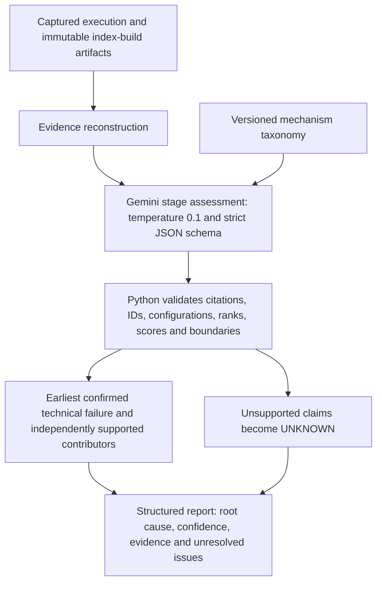

# Stage-based root-cause diagnosis

The default engine evaluates technical failure mechanisms across ten pipeline stages.
The seven Barnett outcomes are available only through the explicit `legacy_fp` mode.
Reports use schema version `2.0`; execution envelopes continue to use version `1.0`.



## Primary taxonomy

`src/rag_diagnostic/mechanisms.py` defines the stage order, mechanism labels,
criteria, and judge schema in one versioned configuration. Both prompting and
validation consume it.

| Stage | Mechanisms |
|---|---|
| Corpus availability (`corpus`) | `MISSING_SOURCE_INFORMATION` |
| Normalization (`normalization`) | `EXTRACTION_LOSS` |
| Chunking (`chunking`) | `CHUNK_FRAGMENTATION` |
| Embedding (`embedding`) | `EMBEDDING_MISMATCH` |
| Storage/indexing (`indexing`) | `INDEXING_FAILURE` |
| Retrieval (`retrieval`) | `TOP_K_EXCLUSION` |
| Reranking (`reranking`) | `RERANKING_DEGRADATION` |
| Selection (`selection`) | `SIMILARITY_CUTOFF_EXCLUSION`, `TOKEN_BUDGET_EXCLUSION` |
| Context (`context`) | `CONTEXT_TRUNCATION`, `CONTEXT_DELIVERY_LOSS` |
| Generation (`generation`) | `INCORRECT_EVIDENCE_EXTRACTION`, `PARTIAL_EVIDENCE_EXTRACTION`, `OUTPUT_FORMAT_VIOLATION`, `SPECIFICITY_MISMATCH` |
| Operational fallback (`operational`) | `UNCLASSIFIED_OPERATIONAL_FAILURE` |

The operational fallback retains the actual observed exception stage as
`technical_stage`. It requires a recorded exception, not simply absent telemetry.

## Evidence reconstruction and validation

The engine combines original telemetry with verified historical index-build
artifacts. Each boundary becomes a named artifact, alongside query, corpus,
chunk, context, response, and delivered-request artifacts. The original trace is
preserved in the report. Budgeted source views remain explicitly incomplete.

For every mechanism, Gemini returns `FAULT`, `CLEAR`, `UNKNOWN`, or
`NOT_APPLICABLE`, supporting and contradicting citations, a rationale, confidence,
proposed primary/contributing designation, and unresolved questions.

Python requires every mechanism exactly once, strict fields and types, valid
verbatim citation spans, stage compatibility, and confidence at least
`abstain_below` (default `0.7`). Unsupported rows become `UNKNOWN`. An unresolved
contradicting citation prevents accepting a fault. Each mechanism has additional
observable prerequisites:

Machine-checkable output constraints override the judge's semantic assessment.
For the recognized JSON-only instruction, Python parses the complete answer;
Markdown fences, extra prose, duplicate keys, invalid constants, and unexpected
keys produce `OUTPUT_FORMAT_VIOLATION` even when the judge proposed `CLEAR` or
supplied unusable citations.

For a judge-proposed fragmentation fault with at least two valid chunk citations,
Python may attach their recorded parsing and chunking boundary artifacts after
verifying unique chunk IDs, document/section identity, neighboring chunk numbers,
and exact source offsets. Added citations are exposed as `derived_evidence` with
`validation_notes`; the original judge reply stays in observations. This resolves
structural provenance only. Missing or ambiguous lineage still abstains, and
Python never creates a fragmentation fault from a split alone.

| Mechanism | Required boundary facts |
|---|---|
| Missing source information | Complete scoped original corpus and cited query. The claim is limited to the snapshot's actual source representation. |
| Extraction loss | Original source passage and complete normalized output mapped to the same document; cited passage absent from normalized output. Semantic loss still needs judge assessment. |
| Chunk fragmentation | Normalized text and neighboring chunks from the same section; exact offsets must reproduce chunk text. The judge assesses whether a relevant relationship was fragmented. |
| Embedding mismatch | Query/document configuration comparison. A fault needs an observed incompatible field; clearing requires model, revision, dimensions, preprocessing and normalization. |
| Indexing failure | Generated/embedded IDs compared with a complete acknowledged indexed ID list. Counts alone cannot prove membership. |
| Top-K exclusion | Selected IDs and cutoff plus a cited unselected deeper-ranked indexed chunk. |
| Reranking degradation | Same candidate identity before and after ranking, with demonstrable demotion or removal. An explicitly unused reranker is only `NOT_APPLICABLE`. |
| Similarity cutoff exclusion | Candidate ID, matching observed score, actual threshold, and an exclusion decision whose score is below that threshold. |
| Token budget exclusion | Candidate ID and exclusion decision with nonnegative token counts and `used_tokens + token_count > budget`. |
| Context truncation | Recorded `pre_truncation` and `post_truncation` text showing removal. |
| Context delivery loss | Assembled context, delivered context, and actual generation prompt; delivered context must occur in that request. |
| Incorrect/partial extraction | Citations from delivered context and answer, plus the actual generation request. Partial extraction also requires the query's information units. |
| Output format violation | Explicit request constraint and answer; recognized JSON-only requests and explicit JSON constraints receive a deterministic format check. |
| Specificity mismatch | Cited, unambiguous request scope and answer; semantic interpretation belongs to the judge. |

The judge must not blame extraction when required facts never reached generation.
It must consider equivalent delivered facts before treating an upstream omission
as a cause. Matching embedding dimensions or hashes never establish semantic
embedding quality. Missing source facts and ingestion loss remain distinct.

Python chooses the earliest validated failure in stage order, overriding the
model's proposed primary designation. Later independently validated failures
become contributors. This is an attributed earliest confirmed cause, not a proof
that an earlier unobserved stage was healthy; unresolved issues remain visible.

## Telemetry additions

New index builds retain chunk document/section lineage and normalized-text start
and end offsets, plus page/parent IDs when available. Unknown page/parent fields
remain null. Chunk IDs map to embedding records. Completed upserts are read back
by ID; their acknowledged membership and embedding configuration are archived.

Queries capture selection decisions (`selected`, `reason`, `score`) and the
actual request assembled immediately before the reference Gemini generation
call, including `delivered_context`. Custom generation implementations must emit
their own `generation_request`; a reconstructed intended prompt cannot prove
delivery. Selection hooks that exclude chunks without a recorded reason use
`unspecified`, which cannot establish threshold or budget exclusion.

External producers can add these fields to `stages`:

```json
{
  "selection": {
    "output_data": {
      "complete": true,
      "decisions": [
        {"chunk_id": "c12", "selected": false, "reason": "similarity_threshold", "score": 0.61, "threshold": 0.7},
        {"chunk_id": "c15", "selected": false, "reason": "token_budget", "token_count": 420, "used_tokens": 900, "budget": 1000}
      ]
    }
  },
  "context_assembly": {
    "pre_truncation": "original context",
    "post_truncation": "context",
    "output_data": "context"
  },
  "generation": {
    "input_data": {"prompt": "Question: ... Context: context", "delivered_context": "context"}
  }
}
```

Record deeper candidates in `deep_retrieval` with IDs, ranks and scores to support
Top-K diagnosis. Saved-trace ingestion never performs a new search. The current
reference pipeline does not introduce a reranker, threshold filter, token-budget
policy or truncation policy solely to populate telemetry. Without their actual
decisions/boundaries, those mechanisms stay unresolved. Original corpus evidence
currently means the captured source JSON text, not an unobserved original PDF.

## Report and migration

The report's `root_cause` contains the mechanism, stage, actual technical stage,
confidence, rationale, evidence and validated designation. It also includes
`contributing_failures`, all `evaluations`, `unresolved_issues`,
`attribution_complete`, original observations, judge reply, settings, source hash
and code revision. No primary FP category is emitted in stage mode.

`status` is `diagnosed` when a fault is supported, `abstained` when none is
supported and any check is unknown, or `no_failure` when all checks are resolved.
Cache identities distinguish stage mode from legacy mode. Low temperature and
cached replay improve consistency; confidence remains an uncalibrated evidence
score. No reference answer or expected fault label enters the judge.

```json
{"assessment_mode": "stage", "abstain_below": 0.7}
```

The existing commands continue to work:

```bash
rag-pipeline ask "<query>" --failure-reason "<reason for review>"
rag-diagnose ingest --trace <printed-trace-path> --json
rag-diagnose watch --trace-dir data/diagnostics --once --json
```

Older traces can be ingested, but missing upstream or delivered-payload evidence
causes abstention for the affected mechanisms. A new index build captures the
additional lineage. FP1–FP7 benchmark scoring requires an explicit config with
`"assessment_mode": "legacy_fp"`; it is not a technical-mechanism benchmark.
